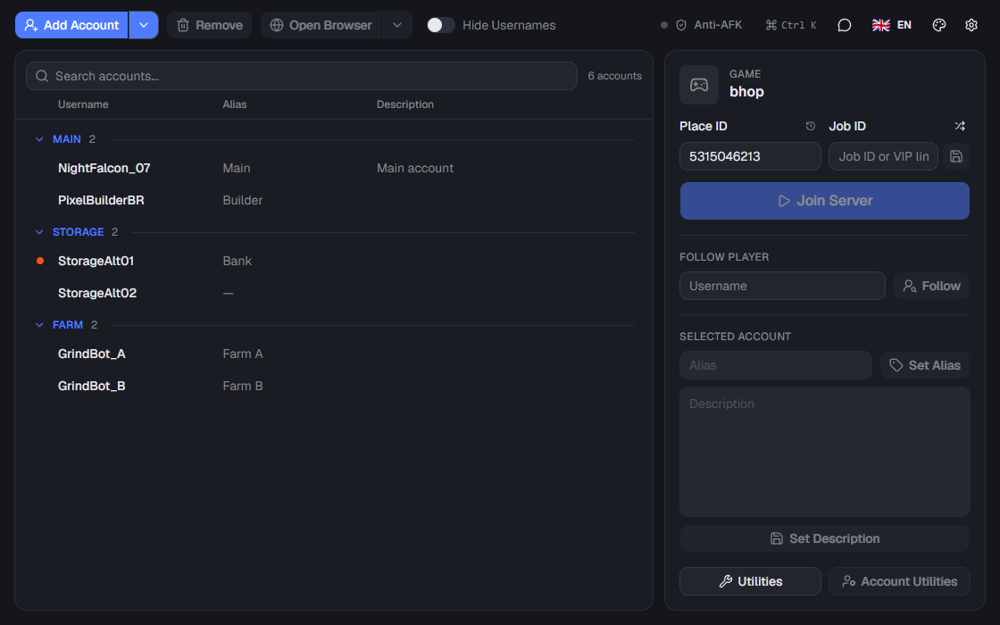
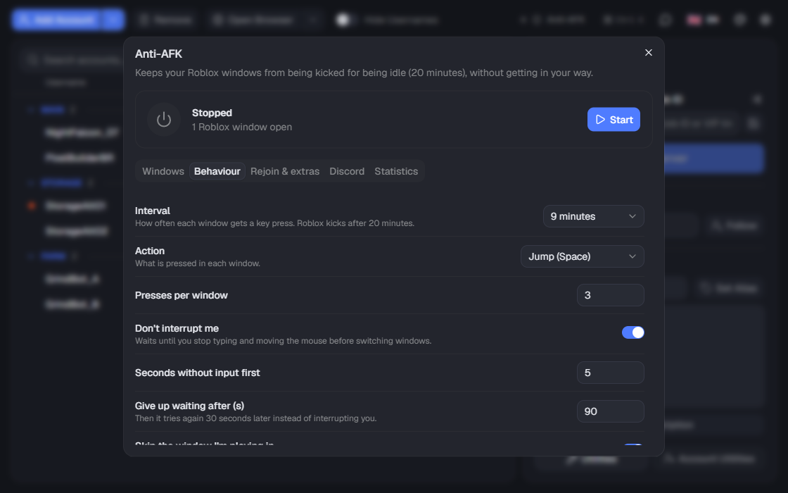
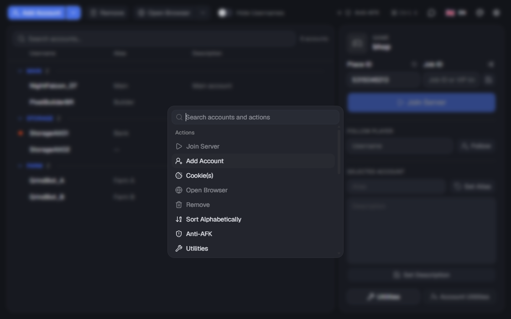
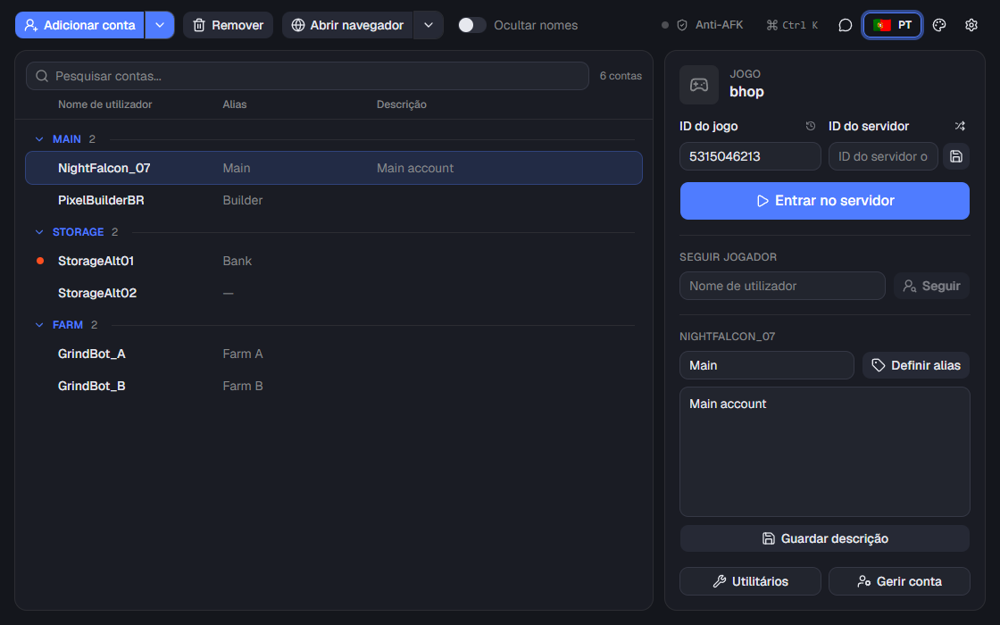
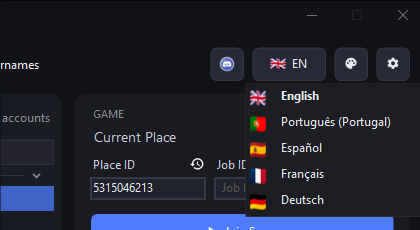
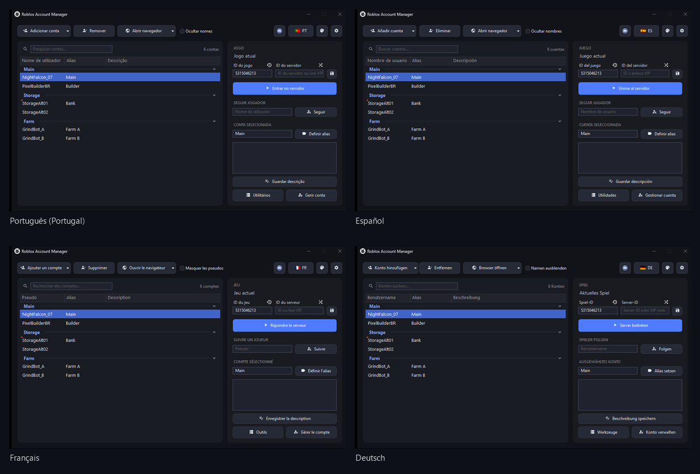
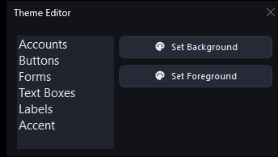

<div align="center">

# Roblox Account Manager

**A modern, translated and faster-to-use edition of [ic3w0lf22's Roblox Account Manager](https://github.com/ic3w0lf22/Roblox-Account-Manager)**

[](https://github.com/Gugas19/Roblox-Account-Manager/releases/latest)
[](LICENSE)


[Download](#download) · [Version 4](#version-4-preview) · [What's new](#whats-new-in-this-edition) · [Languages](#languages) · [Screenshots](#screenshots) · [Building](#building-from-source) · [FAQ](#frequently-asked-questions)

</div>

Keep all your Roblox accounts in one place and join games with any of them in one click: alt accounts, storage
accounts, grinding accounts, with as many Roblox windows open at the same time as you like.

## Download

1. Download the zip from the [latest release](https://github.com/Gugas19/Roblox-Account-Manager/releases/latest).
2. Extract it into a folder of its own, for example on your desktop (it won't run from inside the zip or the Temp folder).
3. Run `RobloxAccountManager.exe`.

- The browser used to add accounts (Chrome for Testing) is downloaded automatically the first time you need it, into
  `%LOCALAPPDATA%\RobloxAccountManager\Chrome`. A progress bar shows while it downloads.
- Needs the .NET Framework 4.7.2 or later, already included in Windows 10 and 11.
- Coming from the original app? Copy your `AccountData.json`, `RAMSettings.ini` and `RAMTheme.ini` next to the new
  `RobloxAccountManager.exe`, your accounts and settings carry over.

## Version 4 (preview)

The whole app rewritten in Rust, in [`rust/`](rust). It opens the same `AccountData.json`, `RAMSettings.ini` and
`RAMTheme.ini` as version 3, so you can switch between them in either direction (just not run both at once).
It's in testing: for now [build it from source](rust/README.md#build), it will be in the releases once it's been
tried with real accounts. Version 3 stays available until then.



- **New interface** built with [shadcn/ui](https://ui.shadcn.com): command palette (`Ctrl+K`) to find any account
  or action, undo after removing accounts, double click to edit an alias, paste a game link straight into Place ID,
  launch progress with cancel, a guided first start, and every setting explained where you change it.
- **Anti-AFK built in**: keeps your Roblox windows from being kicked after 20 minutes idle without getting in your
  way. It waits until you stop typing, skips the window you're playing in, rejoins accounts that got disconnected
  (read from the Roblox log, into the same server), can mute background windows, put them in Windows' efficiency
  mode, arrange them in a grid, send Discord notifications and keep statistics. It keeps running from the tray icon.
- **Command line**, `ram-cli.exe`: list, join, follow, close and import accounts, or control Anti-AFK, from a script
  or a shortcut. When the app is open the command runs inside it.

  ```
  ram-cli join Main Alt2 --place 920587237
  ram-cli join --group Farm --place https://www.roblox.com/games/920587237
  ram-cli follow Alt1 --user Builderman
  ram-cli list --json
  ```
- **Lighter**: one 6 MB exe plus the command line, no .NET Framework or CefSharp, it uses the WebView2 already in
  Windows 10 and 11.
- Same five languages, Windows or password encryption (files encrypted by version 3 open as they are), local web API
  and watcher.

| | |
| :---: | :---: |
|  Anti-AFK |  Command palette (`Ctrl+K`) |



## What's new in this edition

The rest of this page is about version 3, the current release.


### A modern interface
- Dark design with rounded windows, cards, clear icons and a highlighted main action.
- Search your accounts (`Ctrl+F`), see how many are shown and selected, friendly empty states.
- Buttons that need an account are disabled until one is selected, `Delete` removes the selection (after asking).
- Readable check boxes and drop down lists on the dark theme, an accent color you can change in the theme editor.

### Every window in your language
- English, Português (Portugal), Español, Français and Deutsch, see [Languages](#languages).
- Switch at any time with the flag button in the top right, the whole app changes instantly.

### Settings apply instantly
- No more "restart the program": the web server, its port and password, developer mode, account presence,
  automatic cookie refresh, the aging alert, the dark title bar, Multi Roblox and every other setting take effect
  the moment you change them.

### Security
- Your accounts file is protected for your Windows user only (not for anyone using the PC).
- The local web server refuses protected requests without the password once one is set.
- Accepting web server connections from other devices asks Windows for a one time permission instead of having to run
  the whole app as administrator. If you say no, it keeps working for this PC.

### Fixes
- Account changes (alias, description, groups...) were silently not saved during 2 seconds of every minute.
- Scrolling the account list could crash the app with account presence turned off.
- The account counter didn't update after removing accounts.
- After a failed start the web server kept its port, so trying again failed with "access denied".
- Account Utilities reported success, or nothing at all, with an expired session.
- "Dump Details", "Run on Windows Startup" and other options no longer fail silently or crash.

### Under the hood
- The built in browser runs the latest Chrome for Testing (PuppeteerSharp 25).
- Builds with a plain `msbuild -restore` (NuGet PackageReference), no extra setup.
- Automated tests, see [Tests](#tests).

## Languages

| | Language | |
| :---: | :--- | :--- |
|  | English | default |
|  | Português (Portugal) | complete |
|  | Español | complete |
|  | Français | complete |
|  | Deutsch | complete |

The app starts in your Windows language when it's one of these, otherwise in English. Change it with the flag
button or in `Settings` > `General` > `Language`.





<details>
<summary>Adding or improving a translation</summary>

Translations live in [`RBX Alt Manager/Resources/Lang`](RBX%20Alt%20Manager/Resources/Lang), one JSON file per
language where the key is the English text and the value its translation (`{0}`, `{1}` are values filled in by the
app and must be kept). To add a language, create `<code>.json` with the same keys as `pt-PT.json`, add a 48x36 flag
to `Resources/Flags` and add the language to `Lang.Languages` in `Classes/Lang.cs`. The unit tests check that every
text of the app is translated and that no `{0}` is lost.

</details>

## Screenshots

| | |
| :---: | :---: |
|  Search accounts |  Account menu |
|  Utilities: servers, games, favorites, universes, outfits, watcher |  Account utilities |
|  Theme editor | |


The screenshots use made-up demo accounts and are generated by [`Tools/Update-Screenshots.ps1`](Tools/Update-Screenshots.ps1).

## Building from source

Requirements: Windows, [Visual Studio 2022](https://visualstudio.microsoft.com/) or its free Build Tools with the
.NET desktop workload.

```powershell
msbuild "RBX Alt Manager.sln" -restore -p:Configuration=Release -p:Platform=x64
```

The app is built into `RBX Alt Manager\bin\x64\Release`.

Version 4 (Rust) builds with `cargo` and `npm`, see [rust/README.md](rust/README.md).

### Tests

```powershell
pwsh -File Tests\Run-AllTests.ps1           # build + tests that don't open the app
pwsh -File Tests\Run-AllTests.ps1 -WithUI   # also click through every window of a copy with demo accounts
```

See [Tests/README.md](Tests/README.md) for what they cover.

### Updating the screenshots

After changing the interface, run the following and commit the `Images` folder, the README picks the new images up:

```powershell
pwsh -File Tools\Update-Screenshots.ps1
```

It opens a copy of the app with demo accounts (your own accounts and settings are never used) and takes about a minute.

# Warning
If someone asks you to generate an "rbx-player link", **DO NOT** do it, they can use these to join any game using your account, or even launch roblox studio with one of your games. They can do many things in game such as spend your robux or even do things that can get your account terminated. **USE THESE FEATURES AT YOUR OWN RISK**

# Extra Features
Extra features can be enabled in `Settings` > `Developer` > `Enable Developer Mode`.
Beware of the risks that you are taking if you accidentally send something to someone.

If you ever want a friend to join a game using your account, make sure you have the PlaceId and JobId correctly entered, then right click an account, and click "Copy rbx-player link", DO NOT do this if someone asks you for it.

# Developer API
To view the documentation, [click here](https://ic3w0lf22.gitbook.io/roblox-account-manager/).
Change the webserver port if you are planning on using any dangerous functions!
Be careful executing random scripts when having dangerous settings enabled.

# Frequently Asked Questions
## **Q:** Why is this program detected as a virus?

**A:** Open source programs such as this program are commonly detected as viruses because actual malware may be using the same libaries as this one. If you'd like, you can download [visual studio](https://visualstudio.microsoft.com/downloads/) yourself (it's free) and [compile this program on your own](#building-from-source), you may even get the same virus detections as the public release.


## **Q:** How do I enable multi-roblox?

**A:** Open the settings by clicking the gear icon in the top right, in the `General` tab, check `Multi Roblox`. It works as soon as every Roblox window is closed, no restart needed.


## **Q:** Why was multi-roblox disabled by default?

**A:** A byfron developer has stated that using multiple clients may be considered as malicious behavior, so multi-roblox is disabled by default and users can enable the option manually at their own risk.


## **Q:** Why do my accounts have yellow/red dots on them?

**A:** The yellow-red dots that appear on an account means that account hasn't been used in over 20 days, as that day counter goes up, the dot appears more red. You can get rid of this dot by joining a game or enabling developer mode and clicking "Get Authentication Ticket" when you right click an account (works with multiple). You can also turn the alert off in `Settings` > `General` > `Disable Aging Alert`.


## **Q:** How do I backup my accounts file?

**A:** Download [RAMDecrypt](https://github.com/ic3w0lf22/RAMDecrypt) and follow the instructions provided, then you can save the fully decrypted file in google drive, on a flash drive, or where ever you'd like. This does **NOT** work on files that didn't originate from your PC. Accounts protected with a password (`Reset Encryption Method` > `Password protected`) can be moved to another PC as they are.


## **Q:** How do I prevent Windows Defender from deleting alt manager files?

**A:** Add an exclusion for the Roblox Account Manager folder, here's a video on how to add an exclusion: https://youtu.be/1r93NtwZt4o


## **Q:** Can I join vip servers using alt manager?

**A:** Yes you can, just make sure the place id is the same as the game you're trying to join, then paste the whole vip server link into the Job ID box and press Join Server


## **Q:** Can you use this on Mac?

**A:** No, it only runs on Windows.


## **Q:** I’ve encountered a bug/issue on this software

**A:** Open an [issue](https://github.com/Gugas19/Roblox-Account-Manager/issues) with screenshots (if possible) and a descriptive explanation of what happened. The app writes a `log.txt` next to it that helps too (check it doesn't contain anything private before sharing it).


## **Q:** I can’t launch multiple accounts repeatedly.

**A:** This is due to Roblox’s rate limiting


## **Q:** Can you get banned for using this?

**A:** No, you cannot get banned for using this as this does not break Roblox T.O.S although some games may disallow you from having alt accounts so please do your research if you are unsure.

## **Q:** My AccountData file gets corrupted often
**A:** This is due to ProtectedData failing sometimes. You can disable encryption by creating a file called `NoEncryption.IUnderstandTheRisks.iautamor`. Do this at your own risk, nobody except yourself is responsible for your accounts!

# Features
| Feature | Description | How to |
| :--- | :---: | ---: |
| Account Encryption | All your account data is locally encrypted for your Windows user, meaning if someone else gets a hold of your account data, they will **NOT** be able to decrypt it | **DO NOT SHARE YOUR `AccountData.json` FILE AT ALL** |
| Password Encryption | Use a password to encrypt your data | This is recommended as it allows you store your data safely in google drive/similar and won't get corrupted due to you switching computers |
| [Multi Roblox](#q-how-do-i-enable-multi-roblox) | [DISABLED BY DEFAULT, READ FAQ] RAM comes with a built-in multi Roblox allowing multiple Roblox clients to be open at once | **If this doesn't work for you, make sure no Roblox processes are running in the background by checking in task manager** |
| Languages | English, Português (Portugal), Español, Français, Deutsch | Click the flag button in the top right |
| Account Search | Find an account by username, alias, description or group | Type in the search box above the list, or press `Ctrl+F` |
| Load Region | See where a server is located and get an accurate ping reading | Right click a server in the `Server List`, then click `Load Region` **(Requires a valid account to be selected in the main window)** |
| Server List | See a game's servers, including the servers' data such as player count and server ping | Click `Utilities` in the main window |
| [Join Small Servers](https://youtu.be/Red66cV6vVI) | Easily join small servers in games that use lobby starter places to teleport you to another game | Insert the actual game's PlaceId into the text box next to `Refresh` in the `Server List`, click `Refresh`, then right click a server and click `Join Game`, you will hear a beep if successful, once you hear that beep, you can join the main game |
| Account Utilities | Easily change your account password, email, follow privacy, etc | Click `Account Utilities` in the main window **(Requires a valid account to be selected in the main window)** |
| Account Sorting | Sort your accounts easily | Simply drag and drop an account on the list |
| Account Grouping | Sort your accounts by groups, you can also drag and drop accounts into other groups | Right click an account, hover over `Groups`, then click `Move account to` |
| Group Sorting | Sort groups from top to bottom by assigning numbers to them | When creating a group, you can put a number from 0-999 (ex. `1Main`, `007 Bank`, `67 Dead`, ...), sorted from smallest to largest, the numbers will be hidden afterwards |
| Games List | Browse through thousands of games you normally wouldn't see on the front page | Click `Utilities`, then `Games` |
| Favorite Games | Add your favorite games to a list you can easily navigate to | Click `Utilities`, then `Favorites` |
| Recent Games | Saves your recently played games into the `PlaceId` text box | After joining a game, that game will be added to the recent games list, which you can then quickly load up by hovering over the clock icon above the `PlaceId` text box or by typing the game's name into the `PlaceId` text box in the main window |
| Open Browser | Open a browser window using the selected account, allowing you to various settings | Click `Open Browser` in the main window while having an account selected |
| Join VIP Servers |  | Simply place your entire VIP server link into the `PlaceId` text box and RAM will handle the rest |
| Shuffle JobId | Selects a random JobId for every account everytime you press "Join Server" unless you have a JobId set | Click the shuffle icon to toggle JobId Shuffler |
| Save PlaceId & JobId | Save specific `PlaceId`s and/or `JobId`s to specific accounts | Once you enter your desired PlaceId and/or VIP links, click the `Save` icon next to the `JobId` text box |
| Player Finder | Find a player even if their follows are off as long as you know what game they are in | In the `Server List` window, put a player's username into the `Username` text box, then click search. **This may take a while to load and may be patched in the near future** |
| Universe Viewer | View a game's universe | Open `Utilities`, then click `Universe` |
| Outfit Viewer | View other player's outfits and even wear their outfits | Open `Utilities`, then click `Outfits` |
| Sort Account by Usage Date | View the last time you used an account | Make sure to enable headers in the Theme Editor, right click the header and enable `Last Used`, then right click an account, hover `Groups`, and press `Toggle`. You can now click on `Last Used` in the header to sort the accounts. |
| Close Roblox Beta | Detects if the Roblox Beta Home Menu is open and terminates the process if so | Open `Utilities`, then click `Watcher` to modify settings |
| Prevent Duplicate Instances | Automatically shuts down old instances when you launch an account | Account Manager automatically assigns a number called `BrowserTrackerID` to each account allowing it to know if there is an active instance of that specific account running, then proceeds to close it preventing instances of the same account opening more than once |
| Save Passwords | Upon logging into an account, RAM will automatically save that accounts password which can then be copied by right clicking the account, then selecting `Copy Password` | This can be disabled by clicking the settings button (gear cog in top-right corner), the unchecking `Save Passwords` |
| Themes | Customize RAM to your liking, including the accent color | Click the palette button in the top right |
| Developer Mode | Enable hidden features not available to normal users for safety reasons | Click the settings button (gear cog in top-right corner), click `Developer`, then check the `Enable Developer Mode` box |
| Local Web API | Easily use many RAM features by making a simple http request | [Documentation](https://ic3w0lf22.gitbook.io/roblox-account-manager/) |
| Import Cookies | Import accounts using their .ROBLOSECURITY cookies | You can drag and drop one or multiple cookies directly into the program, or click the arrow next to `Add Account` and select `Cookie(s)` |
| FPS Unlocker | Unlocks the Roblox client's FPS using Roblox's ClientAppSettings.json | Settings can be found by clicking the settings cog, then miscellaneous |
| Bulk User Importing | Easily import your accounts by their username & password combos, or by cookies | Click the arrow on the right side of the `Add Account` button, then select user:pass/cookies |
| Automatic Connection Loss Detection | Closes instances that are not connected to a server for a certain amount of time | To enable this, go to `Utilities`->`Watcher`, and make sure `Enable Roblox Watcher` is checked as well as `Exit if No Connection to Server` |
| Automatic Cookie Refresh | Your accounts never become invalidated sitting in the account manager over long periods of time | As long you actively use account manager, your accounts will regularly get new cookies preventing them from being logged out, this does sign you out of other sessions though |
| Join Group | Easily join groups with multiple accounts | Click the arrow on the right side of the `Open Browser` button, then click `Join Group` |
| Quick Log In | Easily log in to an account on a different computer using Roblox's Quick Log In feature | Right click an account, then select `Quick Log In` |
| Anti-AFK (version 4) | Keeps Roblox windows from being kicked for being idle, rejoins disconnected accounts, mutes and arranges windows | Click `Anti-AFK` in the top bar, or `ram-cli antiafk start` |
| Command Line (version 4) | Join, follow, list, close and import accounts from scripts and shortcuts | `ram-cli help` |
| AI Captcha Assistance | Assists you in the "Pick the image" captchas using the Nopecha API (Requires a subscription key) | You can enable auto solve, but it is not recommended to use, your best option is to add a captcha solving extension to the browser along with a BrowserConfig to automatically set the key per new browser opened |

# Credits

- [ic3w0lf22](https://github.com/ic3w0lf22/Roblox-Account-Manager), the original Roblox Account Manager, and everyone who contributed to it.
- [Campionnn](https://github.com/Campionnn/Roblox-Account-Manager), who kept it updated.
- [Agzes/AntiAFK-RBX](https://github.com/Agzes/AntiAFK-RBX), whose features inspired the Anti-AFK of version 4 (written from scratch).
- Version 4 interface: [shadcn/ui](https://ui.shadcn.com), [Lucide](https://lucide.dev) icons, [Tauri](https://tauri.app).
- Icons: [Material Icons](https://fonts.google.com/icons) by Google (Apache License 2.0, see `RBX Alt Manager/Resources/ThirdParty`).
- Flags: [flagcdn.com](https://flagcdn.com) (public domain).

# License

[GNU General Public License v3.0](LICENSE), like the original project.

<details>
<summary>Older previews (original app)</summary>


</details>
