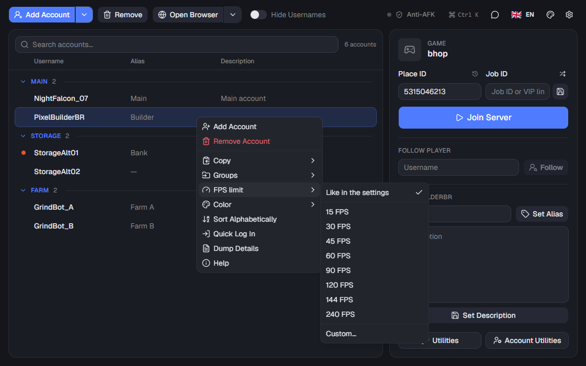

<div align="center">

# Roblox Account Manager

**A modern, translated, Rust rewrite of [ic3w0lf22's Roblox Account Manager](https://github.com/ic3w0lf22/Roblox-Account-Manager), with Anti-AFK and a command line built in**

[](https://github.com/Gugas19/Roblox-Account-Manager/releases/latest)
[](LICENSE)


[](https://github.com/Gugas19/Roblox-Account-Manager/actions/workflows/ci.yml)


[Download](#download) · [Highlights](#highlights) · [Command line](#command-line) · [Languages](#languages) · [Screenshots](#screenshots) · [Building](#building-from-source) · [FAQ](#frequently-asked-questions)

</div>

Keep all your Roblox accounts in one place and join games with any of them in one click: alt accounts, storage
accounts, grinding accounts, with as many Roblox windows open at the same time as you like. Leave them in game for
hours with the built in Anti-AFK, or drive everything from scripts with `ram-cli`.

## Download

1. Download the zip from the [latest release](https://github.com/Gugas19/Roblox-Account-Manager/releases/latest).
2. Extract it into a folder of its own, for example on your desktop (it won't run from inside the zip).
3. Run `RobloxAccountManager.exe`.

In the zip, besides the license:

| File | What it is |
| --- | --- |
| `RobloxAccountManager.exe` | the app, about 6 MB |
| `ram-cli.exe` | the [command line](#command-line) |

- It uses the WebView2 runtime that comes with Windows 10 and 11. Nothing else to install: no .NET, and no bundled browser engine.
- From version 4.0.1 on it [updates itself](#automatic-updates). Version 4.0.0 has to be replaced by hand once.
- The browser used to add accounts (Chrome for Testing) is downloaded automatically the first time you need it, into
  `%LOCALAPPDATA%\RobloxAccountManager\Chrome`. A progress bar shows while it downloads.

### Coming from version 3 or the original app

Copy your `AccountData.json`, `RAMSettings.ini` and `RAMTheme.ini` next to `RobloxAccountManager.exe`.
Your accounts, groups, aliases, settings and theme carry over as they are. That includes password-protected files,
which open with the same password, and the local web API, which answers the same requests (so
[`RAMAccount.lua`](RAMAccount.lua) and other scripts keep working). Don't run both versions on the same files at
the same time: they refuse to start while the other is open.

## Highlights

### A modern interface
- Built with [shadcn/ui](https://ui.shadcn.com): dark by default, with Midnight, Forest and Light themes and an accent color of your choice.
- **Command palette** (`Ctrl+K`): find any account or action and run it from the keyboard.
- Search (`Ctrl+F`), select all (`Ctrl+A`), join with `Enter` or a double click, remove with `Delete`.
- **Undo** after removing accounts, and double click an alias to edit it in place.
- Paste a game link straight into Place ID. Recent games are one click away.
- A progress bar with a cancel button while several accounts launch.
- A guided first start, and every setting explained where you change it. Changes apply instantly, no restart.

### Anti-AFK built in
Roblox kicks you after 20 minutes without input. Anti-AFK keeps every Roblox window active, without getting in your way:
- **It doesn't interrupt you**: it waits until you stop typing and moving the mouse, skips the window you're playing in,
  never acts while a full screen game or video is in front, and puts your window back in front afterwards.
  (Roblox only accepts input while it has the focus: keys and mouse sent in the background are ignored, we tested them
  all, so a short switch to the Roblox window is the only way.)
- **Rejoins disconnected accounts**: it reads the Roblox log, closes the disconnected window and launches that account
  into the same game again, into the same server if you want.
- Choice of key (jump, walk, turn the camera, zoom), interval, presses per window, and resetting the character every round.
- Mute the windows you're not looking at, put background windows in Windows' efficiency mode (less CPU and fan noise),
  arrange them in a grid, hide them or make them see-through.
- Discord notifications when it starts, stops, an account disconnects or something fails.
- Statistics, starts on its own when Roblox opens or when you're away, keeps the PC awake, keeps running in the tray.

### Command line
`ram-cli.exe` joins, follows, lists, closes and imports accounts, and controls Anti-AFK, from scripts, shortcuts or a
scheduled task. When the app is open the command runs inside it, so the window updates live. See [Command line](#command-line).

### Every window in your language
English, Português (Portugal), Español, Français and Deutsch. Switch at any time with the flag button in the top
right, and the whole app changes instantly.

### Automatic updates
The app checks the [releases](https://github.com/Gugas19/Roblox-Account-Manager/releases) when it starts and every
6 hours, downloads a new version in the background, and installs it the next time it starts (or right away with
`Restart to update` in the top bar). It never restarts by itself while you use it.
- Every release is signed with the developer's private key, and the app checks that signature before it keeps a
  download and again before it installs it. A changed download, or a release not signed with that key, is refused,
  even if it comes from this repository.
- The version is part of what's signed, so an old release can't be published again as a newer one, and only newer
  versions are installed.
- Only the two exes are taken from the download, and your accounts and settings are never touched.
- Turn it off, or check by hand, in `Settings` > `General`. `ram-cli update` downloads it from the command line.

### Security
- Your accounts file is encrypted for your Windows user, or with a password if you choose one.
  A password-protected file works on any PC.
- The local web API refuses protected requests without its password, and only listens to this PC unless you allow other devices.
- The command line only talks to the app in its own folder, run by the same Windows user, and never prints cookies.
- Updates are installed only when they're signed with the developer's key (see [Automatic updates](#automatic-updates)).

## Command line

```
ram-cli list [--group <name>] [--json]
ram-cli join <accounts> [--place <id or game link>] [--job <job id or VIP link>]
ram-cli follow <accounts> --user <username>
ram-cli close <accounts> | --all
ram-cli import [file]
ram-cli antiafk [start|stop|now|status]
ram-cli status
ram-cli open
ram-cli update
ram-cli fps <accounts> <5-1000|default>
```

Accounts are named by username, user id or alias (any case). `--all` picks every account, `--group <name>` a group.

```
ram-cli join Main Alt2 --place 920587237
ram-cli join --group Farm --place https://www.roblox.com/games/920587237
ram-cli join --group Farm                     # each account goes to its saved place
ram-cli follow Alt1 --user Builderman
ram-cli list --json
```

- With the app open, the command runs inside it.
- With the app closed, `ram-cli` opens the accounts file itself, without a window. A password-protected file asks
  for the password, or reads it from the `RAM_PASSWORD` environment variable. Anti-AFK needs the app open.
- Exit codes: `0` done, `1` failed, `2` wrong command line. `ram-cli help` explains each command.

## Languages

| | Language |
| :---: | :--- |
|  | English |
|  | Português (Portugal) |
|  | Español |
|  | Français |
|  | Deutsch |

The app starts in your Windows language when it's one of these, otherwise in English.

| | |
| :---: | :---: |
|  |  |
|  |  |

<details>
<summary>Adding or improving a translation</summary>

Translations live in [`lang/`](lang), one JSON file per language. The key is the English text and the value is its
translation. `{0}`, `{1}` are values filled in by the app and must be kept. To add a language, create `<code>.json`
with the same keys as `pt-PT.json`, add a flag to `ui/public/flags` and add the language to `LANGUAGES` in
[`src/core/lang.rs`](src/core/lang.rs). `python tools/strings.py` lists any text without a translation and checks
that every language has the same keys and placeholders.

</details>

## Screenshots

| | |
| :---: | :---: |
|  Anti-AFK |  Anti-AFK: rejoin and extras |
|  Command palette (`Ctrl+K`) |  Search |
|  Account menu |  Account utilities |
|  Utilities: servers, games, favorites, universes, outfits, watcher |  Theme editor |
|  Colors for accounts and groups |  FPS limit per account |


The screenshots use made-up demo accounts and are taken by the interface tests (see [Tests](#tests)).

## Building from source

Requirements: Windows 10 or 11, [Rust](https://rustup.rs) and [Node.js](https://nodejs.org) 20 or later.

```powershell
npm --prefix ui install
npm --prefix ui run build
cargo build --release
```

`RobloxAccountManager.exe` and `ram-cli.exe` end up in `target\release`. While working on the interface,
`npm --prefix ui run dev` serves it with hot reload at localhost:1420, and a debug build (`cargo build`) uses it.

### Layout

```
src/
  app.rs        state shared by everything
  core/         files: settings, accounts, encryption, languages (same formats as version 3)
  roblox/       the Roblox web APIs
  platform/     Windows: processes, windows, mutexes, ping, log file
  services/     launching Roblox, browser, local web API, watcher, Anti-AFK, updater
  commands/     what the interface can ask for, one file per part of the interface
  cli/          ram-cli: options, commands, the pipe to the open app
ui/src/
  components/   one folder per part of the interface (shadcn/ui underneath)
  hooks/ lib/   actions, store, translations, theme
lang/           translations
tests/          interface, command line and updater tests, fixtures
tools/          strings.py (translation check), release.ps1
examples/       sign-release.rs, signs a release for the updater
```

### Tests

```powershell
cargo test --lib                    # file formats, encryption (including a file encrypted by version 3), settings, dates
node tests/cli.mjs [--release]      # the command line, on its own and through an open app
node tests/ui.mjs  [--release]      # the interface, clicking through every window over WebView2's DevTools protocol
node tests/update.mjs               # the updater: a signed update installs, a changed or relabelled one is refused
python tools/strings.py             # every text translated
```

The tests run copies of the app with demo accounts. They never launch Roblox, close it or press keys, and they
refuse to run while your own Roblox Account Manager is open, so your accounts and a game you have open are left alone.

### Releasing

```powershell
cargo run --example sign-release -- new-key   # once: makes the signing key (keep a backup of it)
pwsh -File tools\release.ps1                  # builds, tests, zips and signs target\dist\RobloxAccountManager-<version>.zip
```

Upload the zip and its `.sig` to a GitHub release tagged `v<version>`. The private key stays in
`%USERPROFILE%\.roblox-account-manager\`, never in the repository; installed apps only accept updates signed with it.

The release runs while the app is open (the tests use their own copies, which never take the focus) and takes about
3 minutes. Optional: with a Windows code signing certificate installed, set `RAM_CODESIGN_THUMBPRINT` to its thumbprint
and the exes are signed with it too, so Windows and antivirus software trust them more.

Every push is also built and unit tested on GitHub ([CI](.github/workflows/ci.yml)), without any secret.

### Updating the screenshots

After changing the interface, run the following and commit the `Images` folder. The README picks up the new images.

```powershell
node tests/ui.mjs --readme
```

# Warning
If someone asks you to generate an "rbx-player link", **DO NOT** do it. They can use it to join any game with your account, or even launch Roblox Studio with one of your games. They can do many things in game, such as spend your Robux or do things that get your account terminated. **USE THESE FEATURES AT YOUR OWN RISK**

# Extra Features
Extra features can be enabled in `Settings` > `Developer` > `Enable Developer Mode`.
Beware of the risks you are taking if you accidentally send something to someone.

If you ever want a friend to join a game using your account, make sure the Place ID and Job ID are entered correctly, then right click the account and click "Copy rbx-player Link". DO NOT do this if someone asks you for it.

# Developer API
Enable it in `Settings` > `Developer` > `Enable Web Server`. It answers the same requests as the original app, see the [documentation](https://ic3w0lf22.gitbook.io/roblox-account-manager/), and [`RAMAccount.lua`](RAMAccount.lua) is a ready-made client for it.
Set a password and change the port if you plan on enabling any dangerous method, and be careful running random scripts with those enabled.

# Frequently Asked Questions
## **Q:** Why is this program detected as a virus?

**A:** Tools that launch games and manage logins often get flagged because real malware uses similar techniques. The whole source is here: you can [build it yourself](#building-from-source) and compare.


## **Q:** How do I enable multi-roblox?

**A:** Open the settings with the gear icon in the top right and, in the `General` tab, turn on `Multi Roblox`. It works as soon as every Roblox window is closed, no restart needed.


## **Q:** Is multi-roblox safe?

**A:** It's on by default. A Byfron developer has stated that using multiple clients may be considered malicious behavior, so use it at your own risk, and turn it off in `Settings` > `General` > `Multi Roblox` if you'd rather not.


## **Q:** Will Anti-AFK get my accounts banned?

**A:** It only presses keys in the Roblox windows, like you would. Some games have their own rules against being AFK, so check the rules of the game you play.


## **Q:** Why do my accounts have yellow/red dots on them?

**A:** The dot means the account hasn't been used in over 20 days, and it turns redder as the days go up. Joining a game with the account removes it. You can also turn the alert off in `Settings` > `General` > `Disable Aging Alert`, or turn on `Auto Refresh Cookies` so unused accounts don't get logged out.


## **Q:** How do I back up my accounts file?

**A:** `Settings` > `General` > `Backup` > `Export` saves your accounts encrypted with a password you choose, to keep on Google Drive, a flash drive or another PC. `Import` adds the accounts of a backup that aren't there yet. The backup never holds your accounts in plain text, and it can even be used as an `AccountData.json` with that password.


## **Q:** How do I prevent Windows Defender from deleting the app's files?

**A:** Add an exclusion for the Roblox Account Manager folder. Here's a video on how to add one: https://youtu.be/1r93NtwZt4o


## **Q:** Can I join VIP servers with it?

**A:** Yes. Make sure the Place ID matches the game, paste the whole VIP server link into the Job ID box and press Join Server.


## **Q:** Can you use this on Mac?

**A:** No, it only runs on Windows.


## **Q:** I’ve encountered a bug/issue

**A:** Open an [issue](https://github.com/Gugas19/Roblox-Account-Manager/issues) with screenshots (if possible) and a description of what happened. The app writes a `log.txt` next to it that helps too (check it doesn't contain anything private before sharing it).


## **Q:** I can’t launch multiple accounts repeatedly.

**A:** That's Roblox's rate limiting. Raise `Launch Delay` in the settings.


## **Q:** Can you get banned for using this?

**A:** It doesn't break the Roblox Terms of Service, but some games don't allow alt accounts, so check the rules of the game you play if you're unsure.

## **Q:** My AccountData file gets corrupted often
**A:** Use password protection instead of the default encryption, it doesn't depend on Windows. As a last resort you can turn encryption off by creating a file called `NoEncryption.IUnderstandTheRisks.iautamor` next to the app. Do this at your own risk: anyone who gets that file gets your accounts.

# Features
| Feature | Description | How to |
| :--- | :---: | ---: |
| Account Encryption | Your account data is encrypted for your Windows user, so someone who gets the file can't read it | **DO NOT SHARE YOUR `AccountData.json` FILE AT ALL** |
| Password Encryption | Encrypt your data with a password | Recommended: the file can be stored in Google Drive or moved to another computer |
| [Multi Roblox](#q-is-multi-roblox-safe) | [ON BY DEFAULT, READ FAQ] Several Roblox clients open at once | **If it doesn't work, make sure no Roblox process is running in the background (Task Manager)** |
| Anti-AFK | Keeps Roblox windows from being kicked for being idle, rejoins disconnected accounts, mutes and arranges windows | Click `Anti-AFK` in the top bar, or `ram-cli antiafk start` |
| Command Line | Join, follow, list, close and import accounts from scripts and shortcuts | `ram-cli help` |
| Command Palette | Any account or action from the keyboard | `Ctrl+K` |
| Languages | English, Português (Portugal), Español, Français, Deutsch | Click the flag button in the top right |
| Account Search | Find an account by username, alias, description or group | Type in the search box above the list, or press `Ctrl+F` |
| Undo | Bring back accounts you just removed | Click `Undo` on the message that shows after removing |
| Server List | See a game's servers with their player count and ping | Click `Utilities` in the main window |
| Load Region | See where a server is and get an accurate ping | Right click a server in the server list, then click `Load Region` **(requires a valid account to be selected)** |
| [Join Small Servers](https://youtu.be/Red66cV6vVI) | Join small servers in games that use a lobby place to teleport you | Put the real game's Place ID next to `Refresh` in the server list, refresh, then right click a server and click `Join Game` |
| Player Finder | Find a player even with their follows off, as long as you know their game | In the server list, type the username and click search |
| Account Utilities | Change an account's password, email, display name, follow privacy, add friends, block, sign out other sessions | Click `Account Utilities` **(requires a valid account to be selected)** |
| Account Sorting | Order accounts the way you like | Drag and drop an account in the list, or `Sort Alphabetically` |
| Account Grouping | Put accounts in groups, drag them between groups, rename a group | Right click an account, `Groups`, `Move Account To`; right click a group's header to rename it |
| Group Sorting | Order groups by giving them a number | Name a group with a number from 0-999 in front (ex. `1Main`, `007 Bank`), the number is hidden afterwards |
| Games List | Search Roblox games | `Utilities` > `Games` |
| Favorite Games | Keep the games you play close | `Utilities` > `Favorites` |
| Recent Games | The games you joined last | The clock icon above `Place ID`, or type the game's name into `Place ID` |
| Game Links | Paste a game or VIP server link into `Place ID` | The Place ID (and the VIP server) is taken from the link |
| Open Browser | A browser logged in as the selected account | Click `Open Browser` with an account selected |
| Join Group | Join a group with several accounts | The arrow next to `Open Browser` > `Join Group` |
| Custom URL & Javascript | Open a page and run a script in several browsers | The arrow next to `Open Browser` |
| Shuffle Job ID | A random server every time you press Join, unless a Job ID is set | Click the shuffle icon above `Job ID` |
| Save Place ID & Job ID | Save a place and server to specific accounts, they join it every time | Enter them, then click the save icon next to `Job ID` |
| Universe Viewer | Every place of a game | `Utilities` > `Universe` |
| Outfit Viewer | See other players' outfits and wear them, buy what's missing | `Utilities` > `Outfits` |
| Roblox Watcher | Close Roblox on the beta home menu, without connection, with too little memory or the wrong window title | `Utilities` > `Watcher` |
| Prevent Duplicate Instances | Closes the account's previous Roblox when you launch it again | Each account gets a `BrowserTrackerID` so the app knows which Roblox is whose |
| Save Window Positions | Each account's Roblox opens where it was last time | `Utilities` > `Watcher` |
| Save Passwords | The password you type when logging in is saved, to copy it later | Right click the account > `Copy Password`. Turn it off in `Settings` > `General` |
| Themes | Dark, Midnight, Forest, Light, and your own colors | The palette button in the top right |
| Developer Mode | Extra account menu items: fields, authentication tickets, cookies and launch links | `Settings` > `Developer` > `Enable Developer Mode` |
| Local Web API | Use the app from scripts with plain http requests | [Documentation](https://ic3w0lf22.gitbook.io/roblox-account-manager/), [`RAMAccount.lua`](RAMAccount.lua) |
| Import Cookies | Add accounts from their .ROBLOSECURITY cookies | Drop cookies onto the app, the arrow next to `Add Account` > `Cookie(s)`, or `ram-cli import` |
| Bulk User Importing | Add accounts from username:password lines | The arrow next to `Add Account` > `User:Pass` |
| FPS Unlocker | Raise Roblox's FPS cap, or use your own ClientAppSettings.json | `Settings` > `Miscellaneous` |
| FPS Limit per Account | Each account can have its own frame rate limit (15 for storage alts, 144 for your main), applied when it launches | Right click an account > `FPS limit`, or `ram-cli fps` |
| Colors | Give accounts and groups a color | Right click an account > `Color`, or a group's header > `Group color` |
| Backups | Export your accounts encrypted with a password, import them on any PC | `Settings` > `General` > `Backup` |
| Proxies | Browsers use a random proxy from `proxies.txt` | `Settings` > `Miscellaneous` > `Use proxies` |
| Account Presence | A dot when an account is online, in game or in Studio | `Settings` > `Miscellaneous` |
| Automatic Cookie Refresh | Unused accounts get new cookies so they don't get logged out | `Settings` > `General` > `Auto Refresh Cookies` (signs out other sessions) |
| Quick Log In | Log in to an account on another device with Roblox's Quick Log In | Right click an account > `Quick Log In` |
| Tray | Keep the app, Anti-AFK and the web API running with the window closed | Anti-AFK settings |
| Automatic Updates | New versions download by themselves and install on the next start, only when signed by the developer | `Settings` > `General` |

# Credits

- [ic3w0lf22](https://github.com/ic3w0lf22/Roblox-Account-Manager), the original Roblox Account Manager, and everyone who contributed to it.
- [Campionnn](https://github.com/Campionnn/Roblox-Account-Manager), who kept it updated.
- [Agzes/AntiAFK-RBX](https://github.com/Agzes/AntiAFK-RBX), whose features inspired the Anti-AFK (written from scratch here).
- [Tauri](https://tauri.app), [shadcn/ui](https://ui.shadcn.com), [Lucide](https://lucide.dev) icons.
- Flags: [flagcdn.com](https://flagcdn.com) (public domain).

# License

[GNU General Public License v3.0](LICENSE), like the original project.
